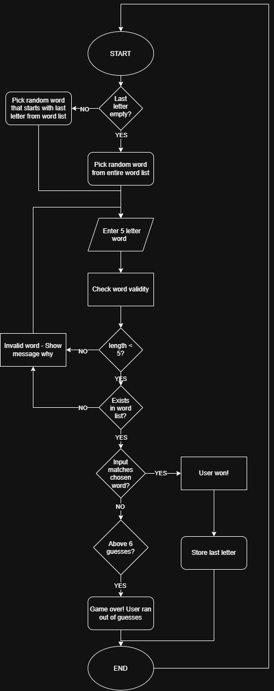
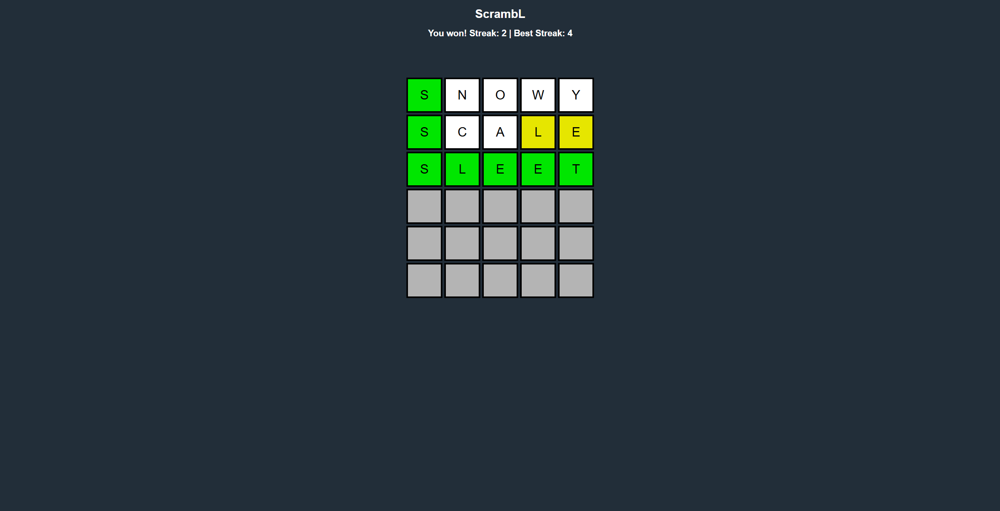

# ScrambL - A descendant of Wordle
Players are presented with a string of characters and attempt to find the hidden word sequence. Players will be informed when they find a letter used in the word with the correct position, incorrect position, or not in the word. When guessed correctly, the last letter will become the start of the new word.
# Table of Contents
- [1 Project Overview](#1-project-overview)
   - [1.1 Main Concept](#11-main-concept)
   - [1.2 Additional Features: Last letter Next Word](#12-additional-features-last-letter-next-word)
   - [1.3 Target Audience](#13-target-audience)
      - [1.3.1 User Profile Example](#131-user-profile-example)
         - [1.3.1.1 Needs](#1311-needs)
         - [1.3.1.2 Expectations](#1312-expectations)
   - [1.4 Requirements](#14-requirements)
      - [1.4.1 Functional Requirements](#141-functional-requirements)
      - [1.4.2 Non-functional Requirements](#142-non-functional-requirements)
         - [1.4.2.1 Usability](#1421-usability)
         - [1.4.2.2 Accessibility](#1422-accessibility)
         - [1.4.2.3 Performance](#1423-performance)
         - [1.4.2.4 Visual Design](#1424-visual-design)
      - [1.4.3 Potential Risks](#143-potential-risks)
         - [1.4.3.1 Challenges](#1431-challenges)
         - [1.4.3.2 Scope](#1432-scope)
         - [1.4.3.2 Dependencies](#1432-dependencies)
- [2 Design](#2-design)
   - [Pseudocode Example](#pseudocode-example)
   - [2.1 Initial Design](#21-initial-design)
      - [2.1.1 Flowchart](#211-flowchart)
   - [2.2 Finalized Design](#22-finalized-design)
      - [2.2.1 Correct Word & Streak Saving](#221-correct-word-streak-saving)
      - [2.2.1 Out of Guesses](#221-out-of-guesses)
- [3 Development & Testing](#3-development-testing)
      - [2.1.1 Test 1](#211-test-1)
      - [2.1.2 Test 2](#212-test-2)
      - [2.1.3 Test 3](#213-test-3)
      - [2.1.4 Test 4](#214-test-4)
      - [2.1.5 Test 5](#215-test-5)
      - [2.1.6 Test 6](#216-test-6)
- [4 Evaluation](#4-evaluation)
   - [4.1 Meeting the Requirements](#41-meeting-the-requirements)
      - [4.1.1 Overall Success](#411-overall-success)
      - [4.1.2 Strengths](#412-strengths)
      - [4.1.3 Weaknesses](#413-weaknesses)
   - [4.2 Reflection & Review](#42-reflection-review)
      - [4.2.1 Development Process, decisions, challenges and problems faced](#421-development-process-decisions-challenges-and-problems-faced)
      - [4.2.2 Area for improvement](#422-area-for-improvement)
   - [4.3 Development Considerations](#43-development-considerations)
      - [4.3.1 Prototyping](#431-prototyping)
      - [4.3.2 Development](#432-development)
         - [4.3.2.1 Strengths](#4321-strengths)
         - [4.3.2.2 Weaknesses](#4322-weaknesses)
      - [4.3.3 Current and Emerging Technologies](#433-current-and-emerging-technologies)
         - [4.3.3.1 Justification](#4331-justification)
      - [4.3.4 Development Tools and Design Methods](#434-development-tools-and-design-methods)
   - [4.4 Technical Problem Review](#44-technical-problem-review)
      - [4.4.1 Development Issue](#441-development-issue)
      - [4.4.2 Considered Solutions](#442-considered-solutions)
      - [4.4.3 Implemented Solution](#443-implemented-solution)
      - [4.4.4 Testing and Outcome](#444-testing-and-outcome)
- [5. References](#5-references)
# 1 Project Overview
## 1.1 Main Concept
1. Guess a random hidden 5 letter word with each guess being a real 5 letter word.
2. Each letter you guess is assigned to the following colour:

    2.1 Green - The guessed letter is in the correct place.

    2.2 Yellow - The guessed letter exists in the word, but is in the wrong place.

    2.3 No change - The guessed letter does not exist in the word.
3. You have 6 attempts to guess the correct word. If you fail to guess correctly after those 6 attempts, the game ends.
## 1.2 Additional Features: Last letter Next Word
1. 5 letter word is chosen, and must be guessed within 6 tries.
2. If the player guesses correctly, a new word is created from the last letter of the correct word.
3. The user continuously guesses until they get a word wrong. Their current and top streak are recorded.
## 1.3 Target Audience
Puzzle players of any age who enjoy a challenge or brain teasers would be the primary audience for this game, however some words could be difficult to guess.
### 1.3.1 User Profile Example
Charlie is 60 years old. In his free time, he enjoys to read the local newspaper and do the daily puzzles, but recently felt like he needs something more complex, as most of the puzzles he has to wait a day to get the results, and some puzzles he feels are very "sameish". He works in a family run business; an antique store selling and buying valuable items. Charlie gets bored as during weekdays, as not many customers visit. He does research on his laptop for antiques but this can feel laborious. He wants to find another way to entertain himself during the day.
#### 1.3.1.1 Needs
- Something fairly challenging that he can think about (a puzzle).
- Content that can be refreshed and give answers quicker.
- A rest from reading and doing puzzles with writing material on a newspaper.
#### 1.3.1.2 Expectations
- A puzzle that he can continuously do throuhout his day.
- A puzzle that is easily accessible.
- Rules of a puzzle he can easily understand and start playing immediately.
- Quicker and clear feedback from the puzzle.
- No time pressure.
## 1.4 Requirements
### 1.4.1 Functional Requirements
- 5 by 6 grid of letter input boxes.
- Single letter uppercase acceptance for each box.
- Word validation (a guess word must exist).
- Letter colour feedback once word is guessed (explained in main concept).
- Limited to a set number of guesses.
- Player should be able to start a new game (pressing enter).

### 1.4.2 Non-functional Requirements
#### 1.4.2.1 Usability
- Simple to learn and play.
- A streak score is updated and shown visually to the user.
- The best streak is kept even when game is lost
- After guessing correctly, a new word is chosen starting with the last letter of the previously guessed word
#### 1.4.2.2 Accessibility
- Good use of colour contrast (background to foreground).
- Dyslexia friendly fonts.
- Larger boxes and text inputs to assist people who have bad eyesight.
#### 1.4.2.3 Performance
- Fast page loading of ~2 seconds (uptrends.com, 2025).
- Fast word checking.
#### 1.4.2.4 Visual Design
- Simple, centre focused centre-aligned input boxes for each guess.
- Clear user feedback (green, yellow, and no colour change guesses, win / loss / incorrect word messages) and instructions on how to play.
- Letter box selection - Current box should be highlighted to show the user where they are typing.
- No bright coloured background as it could be distracting. The focus should be on guessing the word, so a darker background and brighter foreground should be used to emphasise this.
### 1.4.3 Potential Risks
Randomness may not feel as random. Starting with the last letter of the last correct word yields narrowed next words, and may lead to repetition if the 5 letter word list is not big enough.
#### 1.4.3.1 Challenges
- Validating a word will need many branches containing all letters of the alphabet, which can lead to mistakes if not done properly.
- Difficulty of guessing a word may be harder. If a word ends with Y, more rare 54 letter words could be chosen as the next word, making it more challenging to guess.
- Filtering out profanities and other rude or coarse words may be tedious to do.
- Real words that are not in the dictionary may confuse the user.
#### 1.4.3.2 Scope
In scope:
- Core guessing functionality and feedback system given to the user.
- Validating a word exists in the word list.
- An aesthetically pleasing User Interface.

Out of scope:
- A proper data saving system that saves statistics for when you revisit the site.
- Multiplayer system to compare you against how others have done.
- Custom word list category
#### 1.4.3.2 Dependencies
- Creating enough words for the word list for the user to guess and word to be chosen in.
- A random word picked from the word list that is 5 letters long.
- Testing data for validity testing.
- Telling the user the rules of the game and how to play.
# 2 Design
## Pseudocode Example
```pseudocode

fiveLetterWordList = [...]

MAX_GUESSES = 6

wordToGuess = RANDOM(fiveLetterWordList)

WHILE TRUE:
    guesses = 0
    WHILE guesses < MAX_GUESSES + 1:
        guess = LIST(input("Enter a guess: "))

        notInWord = []
        wrongPosition = []
        correctLetters = []

        IF guess IN fiveLetterWordList:
            FOR i IN length(guess):
                IF fiveLetterWordList[i] == guess[i]:
                    APPEND guess[i] TO correctLetters
                ELSE
                    APPEND guess[i] TO notInWord

            FOR letter IN notInWord:
                IF letter IN guess:
                    APPEND letter TO wrongPosition
                    REMOVE letter FROM notInWord
        ELSE:
            Show("Guess is invalid! Not in the word list!")

        IF length(correctLetters) == 5:
            Show("You won! Nice one!")
            break
        ELSE:
            guesses = guesses + 1
            
            Show("Letters"+notInWord+"are not in the word!")
            Show("Letters"+correctLetters+"are in the correct position!")  // Green colour
            Show("Letters"+wrongPosition+"are in the wrong position!")  // Yellow colour

    IF guesses > MAX_GUESSES:
        Show("You lost! You ran out of guesses. The word was "+wordToGuess)
        wordToGuess = RANDOM(fiveLetterWordList)
    ELSE: // User won
        lastLetter = wordToGuess[5]  // fifth letter is the last one
        
        LAST_LETTER_WORDS = []

        FOR word IN fiveLetterWordList:
            IF word[5] == lastLetter:
                APPEND word TO LAST_LETTER_WORDS

        wordToGuess = RANDOM(LAST_LETTER_WORDS)
```
## 2.1 Initial Design
The initial design will follow similar style to the official wordle by the New york times (2021) as described in my Main Concept title, where you have 6 letters and must guess the word in 6 tries.

### 2.1.1 Flowchart
This flowchart demonstrates how the main game logic is handled and how it functions for ScrambL, helping to visualize the game as a whole and how each stage is processed and completed.
</img>
## 2.2 Finalized Design
### 2.2.1 Correct Word & Streak Saving
The finished design with streaks working, and example guessing with message and colour feedback:
</img>

### 2.2.1 Out of Guesses
Here is an example of when the user runs out of guesses. This displays message feedback about them losing and what the word was.

</img>

# 3 Development & Testing
Numerous bugs and tests were performed during the development of ScrambL. Some tests were performed on older versions (6 letter wordle) but have since been accepted as fixes that can be applied to 5 letter words.

The first test was previously 6 letters long and had a different idea. This has since been reverted to 5 due to scope creep.

| Test Number | Test Description | Test Data | Expected Output | Actual output & Pass or Fail | Action Needed |
| ------------- | ------------- | ------------- | ------------- | ------------- | ------------- |
| 1 | Check invalid word with 6 letters | LEMONZ | Invalid word | **PASS:** LEMONZ validity is false | N/A |
| 2 | Check a correct word is invalid if it has < 6 letters | QUALM | Invalid Word | **PASS:** QUALM validity is false | N/A |
| 3 | Check word less than 5 letters | PRIN | Invalid word / not filled | **PASS:** Invalid word! Not filled. Word 'PRIN' is not valid! | N/A |
| 4 | Check a real word that exists in our word list | QUALMS | Valid word | **PASS:** QUALMS validity is true | N/A |
| 5 | Test double letter included only once in the word | Sent: SHEET. Correct Word: AHEAD. | E in position 3 is green. E in position 4 is white. | **FAIL:** E in position 3 is green. E in position 4 is yellow. | List double letters in word to guess, match X occurrences of that letter as max to turn yellow / green. If input contains 2 of that letter when word to guess only has one, match first occurrence of that letter, set other occurrences to grey |
| 6 | Focus selection box and word row is reset to the start | Guess correct word on 4th try | Expected Output | **FAIL:** User guess in the next row and selection box is incremented there. | Reset current row and selection box back to the start row |

First test was to , and the minimum number of letters to accept is dependent on how many input boxes there are in the current row.

### 2.1.1 Test 1
</img>

### 2.1.2 Test 2
The second test below shows that only 6 letter words are accepted, any other length is rejected.

</img>

### 2.1.3 Test 3
Here is the updated version using 5 letter words, but only inputting 4 (or less for that matter) with the output log.

</img>

### 2.1.4 Test 4
Checking word validity

</img>

### 2.1.5 Test 5
A gameplay example, but the word "AHEAD" only contains one E, yet guessing "SHEET" tells us there is another E within the word. This is because it just checks whether its included in the word, not also how many times.

</img>

### 2.1.6 Test 6
A bug after guessing the correct word, guessing was never reset to the first row, nor was the focus box.

</img>
# 4 Evaluation
## 4.1 Meeting the Requirements
### 4.1.1 Overall Success
Overall, this game has accurately met its requirements by re-creating wordle with a different spin on it. Feedback is given visually as a text heading at the top so the user knows when the game is won, lost, or if they have an incorrect word (not in word list). Extra feature was added to pick the last letter of the guessed word and use it at the start of the new chosen word for the user to guess.
### 4.1.2 Strengths
- Visual feedback - Letter colours after guessing a word are shown, letting the user know if a letter is in the correct position, not correct but wrong place, and not in the word. Message feedback is given if the word guessed is incorrect, and if you won or lost the game.
- Simple design - This puts the focus on guessing the word. A darker background allows the user to focus more on the foreground (word guessing).
- Larger letter boxes and dyslexia friendly fonts gives a wider audience range a chance to participate.
### 4.1.3 Weaknesses
- Lack of word selection - Choosing the previous words' last letter to start off the next word limits word choice. For example:
    - Many words can end with letter S, which may be a common starting letter theme.
    - Specific letters could be very rare and not picked, like ending with Z or X
- Currently there is no way to reset a word without losing your streak
- No mobile / tablet support. This group may find it difficult to use ScrambL.
## 4.2 Reflection & Review
### 4.2.1 Development Process, decisions, challenges and problems faced
Building ScrambL incrementally allows me to find bugs and log my development process better. Developing this, I first created a Python mockup version which worked only in console to prototype my main solution, as I was more familiar with this programming language, figuring out how I would go about doing this for JavaScript (JS). Following this, I followed through with reading up on JS using varying sources such as freeCodeCamp, stackoverflow, and w3schools.

When prototyping the main idea, I created the letter boxes first; 6 of them, as my idea was to initially have 6, and guessing each word would reduce it lower to 5 letter word, then 4, and 3. I reverted this change as my idea was too difficult to implement and due to the time constraint I had for this project.

Through learning about event handling (when a user enters letters into each box), and how to validate the inputs, I collected a large 5 letter word list.

### 4.2.2 Area for improvement
- Developing UI compatability with devices such as mobile and tablet support would be the next step before advertising online, allowing for a wider audience range to reach.
- Wins and losses could also be added to display the users total games played, and percentage won or lost, giving them some insight into how successful they are at guessing each word.
## 4.3 Development Considerations
### 4.3.1 Prototyping
Developing a Python prototype helped me understand how this would be programmed in JavaScript and HTML, building the logical foundation of how Wordle worked and thinking of ideas I could include.
### 4.3.2 Development
Using an iterative development process using the agile model to provide me with further flexibility, adaptation, and more rapid development (GeeksforGeeks, 2018). I would first define my requirements needed for the current process, and construct that specific part of the program. Tests were performed and recorded, with further fixes if it failed, and kept retesting it until it worked. I used this approach as it supports my initial prototype built in Python, where the same development process was used.
#### 4.3.2.1 Strengths
- Easier incremental debugging
- Gradual improvement with logging of changes on GitHub.
#### 4.3.2.2 Weaknesses
- Focus was sometimes higher on the smaller things such as style and background colour than the main development.
- Sometimes testing was not thorough enough, and a retest was needed with new solutions put in place, and comitted to GitHub.
### 4.3.3 Current and Emerging Technologies
- Visual Studio Code:
    - HTML & CSS used for designing how ScrambL looks
    - JavaScript used for game logic and making HTML interactable (input boxes, custom messages)

Using HTML, CSS, and JavaScript was used as they all accessible and sufficiently appropriate for this small game.
#### 4.3.3.1 Justification
Developing a prototype and creating tests were useful when developing the games logic, as it provided insight into what went wrong and how it was fixed, while keeping a log on my fixes so completing the test again would not need to be done.
### 4.3.4 Development Tools and Design Methods
- Python was used as the prototype allowing for more experimentation without worrying about the design.
- GitHub & GitHub Desktop used for version control, updating changes, and storing the codebase.
- Developer Tools - F12 gives access to the JavaScript console, used to debug code with output logs.
- Pseudocode - Planned game logic with a more simple design
## 4.4 Technical Problem Review
This problem focuses on navigation functionality.
### 4.4.1 Development Issue
When guessing a word, the user would have to manually `TAB` to each box which became repetitive and is less user friendly. If the user wanted to delete a letter they would have to press `SHIFT+TAB` to go back boxes one at a time which is time consuming.

Additionally, when navigating this way, you could cycle to the next row despite the word to be guessed must be in the first unfilled row from top to bottom. The unfilled boxes were still editable.
### 4.4.2 Considered Solutions
Restrict the user's navigation to the current row with one or more of the following:
1. Keep existing manual `TAB` and `SHIFT+TAB` navigation with the current row restriction to keep them from going out of bounds.
2. Auto navigation on letter pressed. Backspace to delete the last letter but no arrow key navigation to a specific letter using JS input event handling with focus on next / previous letter on key press.
3. Auto navigation and arrow key navigation.
### 4.4.3 Implemented Solution
Going with option 2, I implemented event handling to improve letter box navigation, which moves the focus to the next box when the user inputs a letter, and backspace to delete a letter and focus on the prior box.

When pressing backspace to move back a letter box, or the move to the next box when typing a letter, I made sure to stay in the bounds of the maximum and minimum limit, so the code does not break and try access a letter box that is non existent.
### 4.4.4 Testing and Outcome
By typing out a word, each input box moves as expected. Deleting letters also work the same way, and the focus is shifted back a box until it cant.

Pressing `TAB` and `SHIFT+TAB` were made redundant, but still can access other boxes out of bounds. Despite this, users can always access the first row by going back with `SHIFT+TAB`. This is not documented in the rules, as it is not meant to be used.
# 5. References
- Benveniste, Alexis, and Jackie Frere. “A Collection of the Best Wordle Tips and Tricks.” The New York Times, 10 Feb. 2022, https://www.nytimes.com/2022/02/10/crosswords/best-wordle-tips.html. Accessed 23 Sept. 2026.
- developer.mozilla.org. “HTML input element” MDN Web Docs, 10 Apr. 2025, https://developer.mozilla.org/en-US/docs/Web/HTML/Reference/Elements/input. Accessed 23 Sept. 2026.
- draw.io (2025). Flowchart maker & online diagram software. app.diagrams.net. Available at: https://app.diagrams.net/ [Accessed 26 Oct. 2026].
- figma.com (2023). Blue-gray color: Hex code, palettes & meaning. Figma. Available at: https://www.figma.com/colors/blue-gray/ [Accessed 25 Oct. 2026].
- GeeksforGeeks (2018). Agile development models software engineering. GeeksforGeeks. Available at: https://www.geeksforgeeks.org/software-engineering/software-engineering-agile-development-models/ [Accessed 26 Oct. 2026].
- “HTML Input Tag.” www.w3schools.com, 2024, https://www.w3schools.com/tags/tag_input.asp. Accessed 24 Sept. 2026.
- New york times (2021). Wordle - a daily word game. www.nytimes.com. Available at: https://www.nytimes.com/games/wordle/index.html [Accessed 21 Oct. 2026].
- Stack Overflow (2017). What is the JavaScript version of sleep()? Stack Overflow. Available at: https://stackoverflow.com/questions/951021/what-is-the-javascript-version-of-sleep [Accessed 7 Oct. 2026].
- “Word List By Length” 20 Jul. 2017, https://github.com/MagicOctopusUrn/wordListsByLength. Accessed 25 Sept. 2026.
- W3Schools (n.d.). JavaScript switch statement. www.w3schools.com. Available at: https://www.w3schools.com/js/js_switch.asp [Accessed 21 Oct. 2026].
- “W3Schools Online HTML Editor” www.w3schools.com, 2024, https://www.w3schools.com/html/tryit.asp?filename=tryhtml_styles_background-color. Accessed 25 Sept. 2026.
- Uptrends.com. “The Psychology of Web Performance.” uptrends.com, Apr. 2025, https://www.uptrends.com/blog/the-psychology-of-web-performance. Accessed 25 Sept. 2026